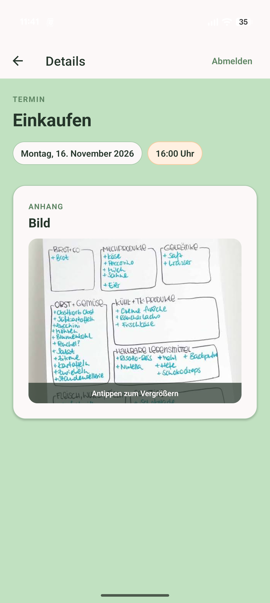
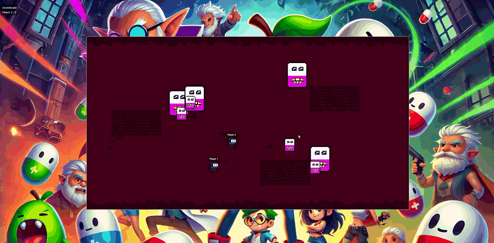

# Calogero Montante · Projektportfolio

Ich studiere Mensch-Technik-Interaktion an der Hochschule Ruhr West. Hier stelle ich Projekte vor, die im Studium und aus eigenem Interesse entstanden sind.

## FastSchedule

**Mobile App für Termine, Erinnerungen und ergänzende Notizen**

FastSchedule soll die alltägliche Terminplanung durch eine übersichtliche, visuell reduzierte Oberfläche erleichtern. Einträge lassen sich um Beschreibungen, Bilder und Sprachmemos ergänzen.

**Mein Beitrag**

- Aufbau der Navigationsarchitektur 
- Einrichtung des Firebase-Backends für Anmeldung und Datenhaltung
- Umsetzung der Funktionen zum Hinzufügen von Bildern, Sprachmemos und Notizen sowie die detaillierte Terminansicht
- Gestaltung der Benutzeroberfläche

**Technologien** · JavaScript, React Native, Expo, Firebase

  
  
  
  

## Planspiel Mobilitätswende

**Interaktives Hochschulprojekt zu Entscheidungen über automatisierte Mobilität in Bottrop**

Spielende wählen innerhalb eines Budgets Maßnahmen aus und verfolgen deren Auswirkungen auf Faktoren wie Akzeptanz, Vertrauen und den simulierten Stauindex. Eine Karte macht die Verkehrslage sichtbar. Nach den Spielrunden werden Anforderungen und Ergebnisse ausgewertet.

**Mein Beitrag**

- Frontend : Entwicklung der dynamischen Kennzahlenübersicht und der abschließenden Spielauswertung
- Verbindung von Front- und Backend über eine REST-API
- Übermittlung von Spielentscheidungen und Verarbeitung der zurückgegebenen Spielstände
- Integration der Leaflet-Karte mit OpenStreetMap-Kartenmaterial
- Verknüpfung der Straßenvisualisierung mit den simulierten Verkehrswerten

**Technologien** · TypeScript, Angular, REST/HTTP, Leaflet, OpenStreetMap

Ergebnisansicht ansehen

## Pearman

**Multiplayer-Browserspiel aus einem Hochschul-Teamprojekt**

Pearman ist ein browserbasiertes Multiplayer-Spiel mit endlosen Gegnerwellen und einem Upgrade-System. Ziel des Projekts war es, die Kommunikation zwischen Frontend und Backend sowie die Synchronisierung des Spielgeschehens zwischen mehreren Spielenden praktisch umzusetzen.

**Mein Beitrag**

- Mitarbeit an der Backend-Entwicklung
- Erstellung der Maps
- Upgrade-System

**Technologien** · TypeScript, Node.js, Express, Socket.IO

## PoE2 Campaign Companion

**Persönliches Projekt mit KI-generierter Implementierung**

Ein interaktiver Begleiter für die Kampagne von Path of Exile 2 mit durchsuchbaren Routennotizen, Filtern, Fortschrittsanzeige und einer Build-Anzeige.
Die Website soll mir und meinen Freunden helfen möglichst schnell durch die Kampagne zu kommen.

Die Implementierung wurde fast vollständig mit ChatGPT erstellt.

**Mein Beitrag**

- Produktkonzeption
- UX-Gestaltung
- Steuerung der KI-gestützten Entwicklung

[Live-Demo öffnen](https://poe2-campaign-companion.glazedgenet8.chatgpt.site/)

---

Die Hochschulprojekte sind im Rahmen des Studiums entstanden. Bei Teamprojekten beziehen sich die Angaben unter „Mein Beitrag“ auf meinen eigenen Aufgabenbereich. Projektbeschreibungen und Demonstrationen stehen hier im Vordergrund.
