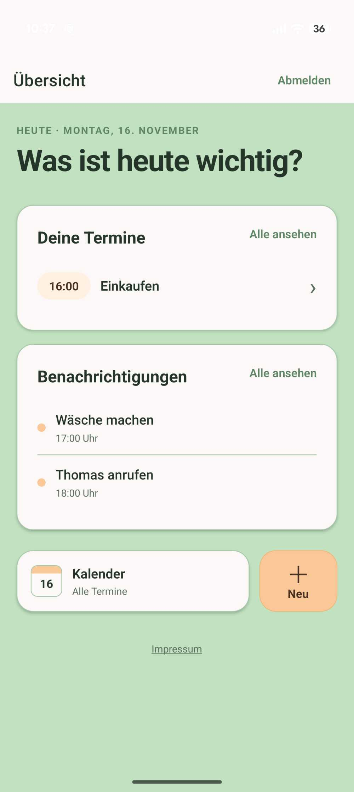
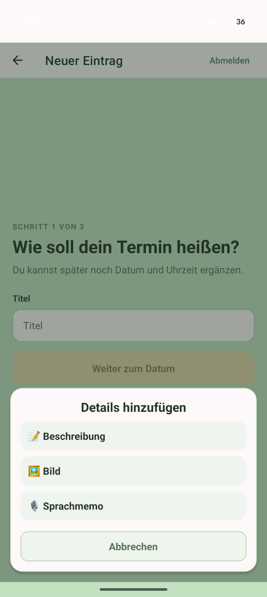
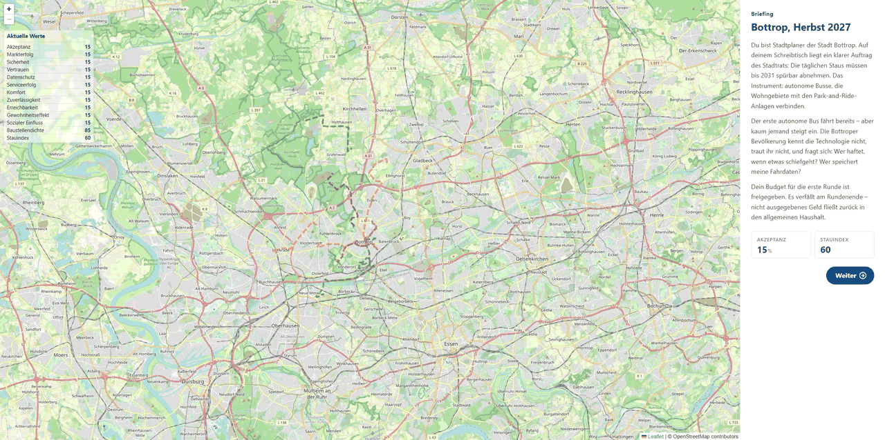
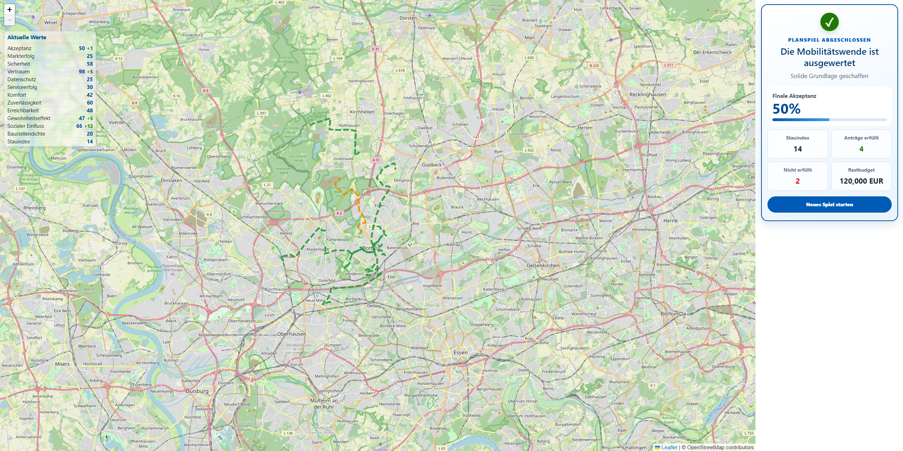

# Calogero Montante · Projektportfolio

Ich studiere Mensch-Technik-Interaktion an der Hochschule Ruhr West. Hier zeige ich ausgewählte Hochschul- und persönliche Projekte aus der Web- und App-Entwicklung.

## FastSchedule

**Mobile App für Termine, Erinnerungen und ergänzende Notizen**

FastSchedule bündelt anstehende Termine und Erinnerungen in einer Tagesübersicht. Einträge lassen sich um Beschreibungen, Bilder und Sprachmemos ergänzen. Die Oberfläche führt schrittweise durch das Anlegen eines neuen Eintrags.

**Mein Beitrag**

- Aufbau der Navigationsarchitektur und Umsetzung der App-Funktionen.
- Einrichtung des Firebase-Backends für Anmeldung und Datenhaltung.
- Umsetzung der Funktionen zum Hinzufügen von Bildern und Sprachmemos.

**Technologien** · JavaScript, React Native, Expo, Firebase

  
  
  

## Planspiel Mobilitätswende

**Interaktives Hochschulprojekt zu Entscheidungen über autonome Mobilität in Bottrop**

Spielende wählen innerhalb eines Budgets Maßnahmen aus und verfolgen deren Auswirkungen auf Faktoren wie Akzeptanz, Vertrauen und den simulierten Stauindex. Eine Karte macht die Verkehrslage sichtbar. Nach den Spielrunden werden Anforderungen und Ergebnisse ausgewertet.

**Mein Beitrag**

- Umsetzung des Frontends und Verbindung mit dem Backend über eine REST-API.
- Übermittlung von Spielentscheidungen und Verarbeitung der zurückgegebenen Spielstände.
- Integration der Leaflet-Karte mit OpenStreetMap-Kartenmaterial.
- Verknüpfung der Straßenvisualisierung mit den simulierten Verkehrswerten.

**Technologien** · TypeScript, Angular, REST/HTTP, Leaflet, OpenStreetMap

Ergebnisansicht ansehen

## Pearman

**Multiplayer-Browserspiel aus einem Hochschul-Teamprojekt**

Pearman ist ein browserbasiertes Spiel mit mehreren Spielenden, Gegnern und einem Upgrade-System. Die Demonstration zeigt einen gemeinsamen Spielausschnitt mit zwei Figuren.

**Technologien** · TypeScript, Node.js, Express, Socket.IO

## PoE2 Campaign Companion

**Persönliches Projekt mit vollständig KI-generierter Implementierung**

Ein interaktiver Begleiter für die Kampagne von Path of Exile 2 mit durchsuchbaren Routennotizen, Filtern, Fortschrittsanzeige und einem Build-Bereich.

Die Implementierung wurde vollständig mit ChatGPT erstellt. Das Projekt ist als KI-gestütztes persönliches Projekt gekennzeichnet.

[Live-Demo öffnen](https://poe2-campaign-companion.glazedgenet8.chatgpt.site/)

---

Die Hochschulprojekte sind im Rahmen des Studiums entstanden. Bei Teamprojekten beziehen sich die Angaben unter „Mein Beitrag“ auf meinen eigenen Aufgabenbereich. Projektbeschreibungen und Demonstrationen stehen hier im Vordergrund.
